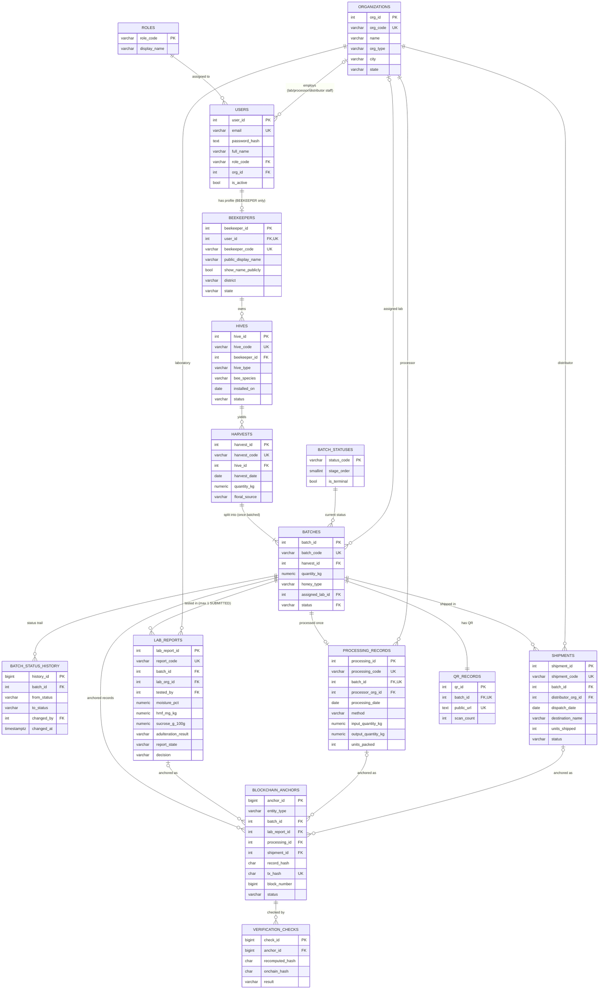

# 02 — ER Diagram

GitHub and VS Code (with a Mermaid extension) render the diagram below automatically. For the project report, paste the block into <https://mermaid.live> and export PNG/SVG.

## 1. Entity–Relationship diagram (PostgreSQL)

`batch_status_transitions` (allowed from→to pairs) and `mongo_outbox` (retry queue) are support tables and are omitted from the picture for readability.

## 2. Cardinalities in words

| Relationship | Cardinality | Enforced by |
|---|---|---|
| Role → Users | 1 : N | FK `users.role_code` |
| Organization → Users | 1 : N (only staff roles) | FK + CHECK `users_org_matches_role` + trigger (org type matches role) |
| User → Beekeeper profile | 1 : 0..1 | FK `beekeepers.user_id` **UNIQUE** + trigger (user must be BEEKEEPER) |
| Beekeeper → Hives | 1 : N | FK `hives.beekeeper_id` |
| Hive → Harvests | 1 : N | FK `harvests.hive_id` |
| Harvest → Batches | 1 : N, Σ batch kg ≤ harvest kg | FK + trigger with row lock |
| Batch → Lab reports | 1 : N history, **at most 1 SUBMITTED, 1 DRAFT** | partial unique indexes |
| Batch → Processing record | 1 : 0..1 | FK `processing_records.batch_id` **UNIQUE** |
| Batch → Shipments | 1 : N, Σ units shipped ≤ units packed | FK + trigger with row lock |
| Batch → QR record | 1 : 1 | FK `qr_records.batch_id` **UNIQUE** (created in the same transaction as the batch) |
| Record → Blockchain anchors | 1 : N attempts, **1 live per contract** | typed FKs + CHECK + partial unique index |
| Anchor → Verification checks | 1 : N | FK |

## 3. Normalization (to 3NF)

**1NF — atomic values, no repeating groups.**
Each measurement has its own column (`moisture_pct`, `hmf_mg_kg` …). Repeating groups become rows in their own table: many shipments per batch are rows in `shipments`, not `shipment1`, `shipment2` columns. Spectral data (128+ numbers per acquisition) is *not* forced into SQL; it lives in MongoDB (see doc 04).

**2NF — no partial dependency on part of a key.**
Every table has a single-column surrogate primary key, so a partial dependency is impossible.

**3NF — no transitive dependency (non-key → non-key).**
- `batches` stores `harvest_id`, **not** `hive_id` or `beekeeper_id`. Who owns a batch is found by joining `batches → harvests → hives → beekeepers`. Storing `beekeeper_id` in `batches` would be a transitive dependency (batch → harvest → hive → beekeeper) and could become inconsistent.
- `lab_reports` stores `lab_org_id`, not the lab's name or city.
- `users` stores `role_code`, not the role's display name.

**Deliberate, documented exceptions**

| Column | Why it is kept | How consistency is protected |
|---|---|---|
| `batches.status` (derivable from which stage records exist) | Fast queue queries (`WHERE status = 'LAB_PASSED'`) and a clear state machine | Transition table + trigger; every change written to history |
| `qr_records.public_url` (derivable from `batch_code`) | Printed QR labels must keep working if `PUBLIC_BASE_URL` changes later | Written once, UNIQUE |
| `blockchain_anchors.canonical_json` | Shows exactly what was hashed (for viva/debugging) | Write-once evidence; anchors cannot be deleted |
